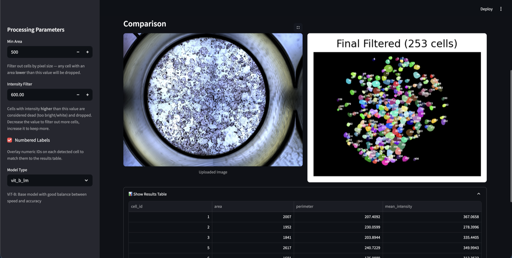
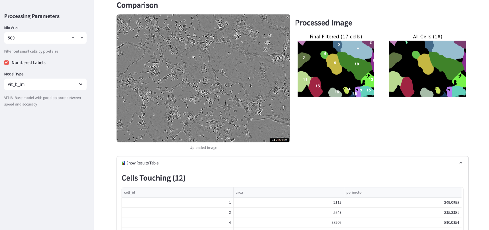

# micro-SAM Osteoclast Pipeline

A [micro-SAM](https://computational-cell-analytics.github.io/micro-sam/micro_sam.html)-based
segmentation and quantification pipeline for **osteoclast microscopy images**. This repository
bundles two companion tools as git submodules:

| Submodule | Purpose | Interface |
|---|---|---|
| [`trap-positive-osteoclasts/`](trap-positive-osteoclasts/) | Segmentation of **TRAP-stained** osteoclasts with per-cell area / intensity filtering | Streamlit UI |
| [`incucyte_osteoclasts/`](incucyte_osteoclasts/) | Segmentation of **Incucyte time-lapse** images, including 5-position well stitching and plate coverage | Streamlit UI + CLI |

Both tools share the same foundation: a micro-SAM model segments individual cells, shape
features are extracted per cell, configurable filters remove fragments, and results are written
as per-image CSVs plus a combined `FINAL_STATS.csv`.

## The two apps

| TRAP-positive osteoclasts | Incucyte osteoclasts |
|:---:|:---:|
| [](assets/trap-positive-app.png) | [](assets/incucyte-app.png) |
| *Single-image result: uploaded TRAP image, filtered segmentation, and per-cell features.* | *Single-image result: Incucyte well, 253 filtered cells, and per-cell features.* |

---

## Repository layout

```
micro_sam_based_pipeline_ost/
├── trap-positive-osteoclasts/   # submodule — TRAP-stained osteoclast analyzer
├── incucyte_osteoclasts/        # submodule — Incucyte time-lapse analyzer
└── README.md                    # this file
```

Each submodule has its own detailed README; this page covers how to obtain and run them
together.

---

## Getting started

### Clone with submodules

```bash
git clone --recurse-submodules git@github.com:shtengel/micro_sam_based_pipeline_ost.git
cd micro_sam_based_pipeline_ost
```

Already cloned without them?

```bash
git submodule update --init --recursive
```

### Environment

Both tools depend on **micro-SAM**, which is distributed via conda. Follow the official
installation guide:

👉 **[micro-SAM installation instructions](https://computational-cell-analytics.github.io/micro-sam/micro_sam.html#from-conda)**

Then activate the environment and install each submodule's dependencies:

```bash
conda activate micro-sam

pip install -r trap-positive-osteoclasts/requirements.txt
pip install -r incucyte_osteoclasts/requirements.txt
```

> **Incucyte checkpoint:** `incucyte_osteoclasts` ships a fine-tuned `vit_b_lm_incucyte`
> checkpoint tracked by **Git LFS**. After cloning, pull the actual weights:
>
> ```bash
> cd incucyte_osteoclasts
> git lfs pull
> ```
>
> If the checkpoint is still a small pointer file, segmentation fails with an
> `invalid load key` error.

---

## Running the tools

### TRAP-positive osteoclasts

```bash
cd trap-positive-osteoclasts
streamlit run app2.py
```

Opens a Streamlit app with **Single Image** and **Batch Processing** tabs. Detected cells are
filtered by:

- **Min Area** — drop cells below a pixel-area threshold (fragments, debris).
- **Intensity Filter** — drop mean-intensity outliers (over-stained / dead cells).

Outputs per image: `_original.png`, `_features.csv`, `_final_filtered.png`; batches also
produce `FINAL_STATS.csv`. See the [submodule README](trap-positive-osteoclasts/README.md) for
the full parameter reference and a recommended calibration workflow.

### Incucyte osteoclasts

```bash
cd incucyte_osteoclasts

# Web UI
streamlit run ui.py

# CLI
python main.py --input /path/to/images --output /path/to/results
```

In addition to single-image and batch processing, this tool recognizes Incucyte 5-position
filenames (`VID167_E7_3_02d18h00m`), groups them by `VID_plate_time`, and stitches the five
tiles (top, left, center, right, bottom) into a 3×3 well grid to compute combined plate
coverage. It also counts touching-cell neighbours. See the
[submodule README](incucyte_osteoclasts/README.md) for the filename format, CLI flags, and
stitching requirements.

---

## Shared outputs

Both tools write, per processed image:

| File | Contents |
|---|---|
| `<image>_features.csv` | One row per detected cell: `cell_id`, `area`, `perimeter`, plus `mean_intensity` for TRAP images. |
| `<image>_final_filtered.png` | Debug visualization of the original image, all detected cells, and the filtered result. |
| `<image>.png` / `<image>_original.png` | The input image saved alongside results (batch mode). |

Batch runs additionally produce `FINAL_STATS.csv`, one row per image (Incucyte: per well/time
group), with `num_cells`, `mean_area`, `mean_perimeter`, `plate_coverage_percent`, and — for
Incucyte — `cells_touching`.

> **Note:** Segmentation can vary slightly across machines due to hardware, floating-point
> behavior, and dependency versions. Verify outputs on your own system before drawing
> conclusions.

---

## License

- `trap-positive-osteoclasts` is released under the MIT License (see its `LICENSE` file).
- `incucyte_osteoclasts` states MIT in its README but does not currently include a `LICENSE`
  file in the repository.
